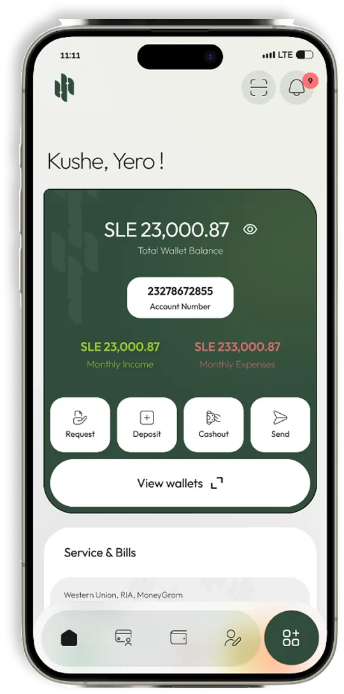
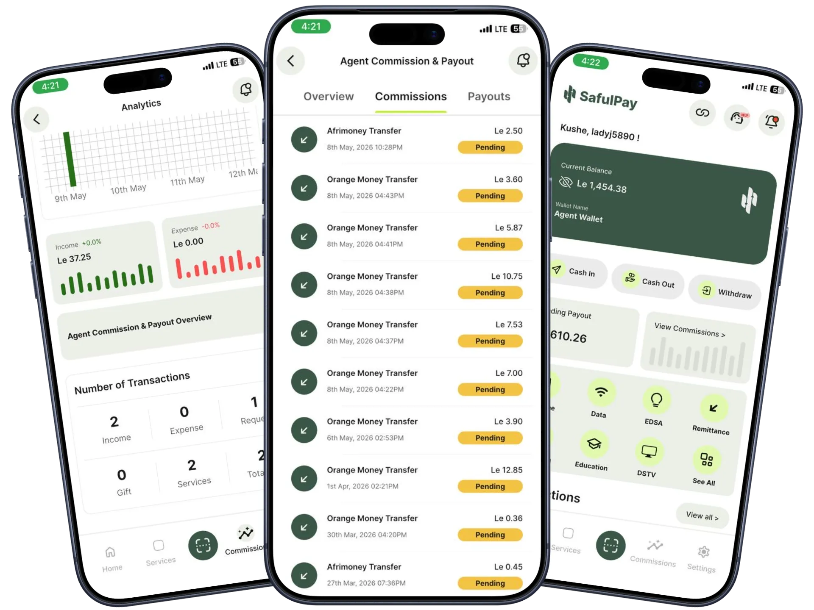
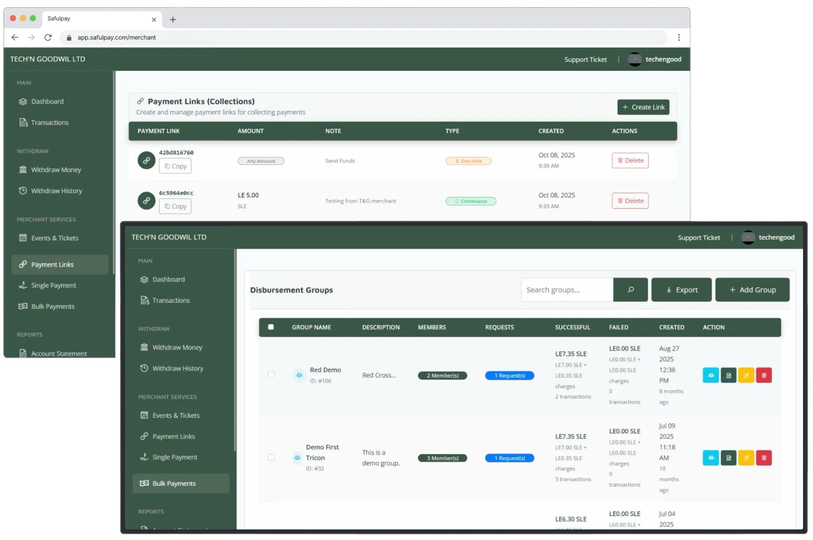
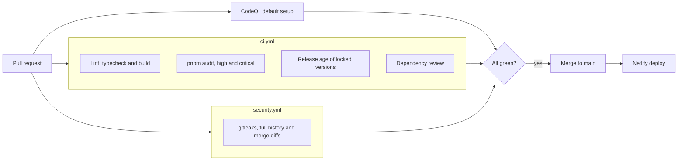

<p align="center">
  
</p>

<h1 align="center">SafulPay Website v2</h1>

<p align="center">
  
</p>

<p align="center">
  <a href="https://github.com/TECH-N-GOODWILL-LIMITED/SafulPay-Website-v2/actions/workflows/ci.yml"></a>
  <a href="https://github.com/TECH-N-GOODWILL-LIMITED/SafulPay-Website-v2/actions/workflows/security.yml"></a>
  
  
  
  <a href="https://app.netlify.com/projects/safulpay/deploys"></a>
</p>

The marketing site for **SafulPay** — Sierra Leone's financial bridge that connects every wallet, bank, and bill into a single app. This repo is the public-facing site that tells that story to four audiences: end users, agents, merchants, and developers.

> _"One app sits in the middle of every wallet, bank and bill."_

---

## What the site covers

<p align="center">
  
</p>

| Section                  | What it sells                                                                                                             |
| ------------------------ | ------------------------------------------------------------------------------------------------------------------------- |
| **Home**                 | The pitch: one app for sending, paying bills (EDSA, WAEC, DSTV), buying airtime, and receiving remittances.               |
| **Bridge**               | The infrastructure narrative — mobile money networks, banks, and global remittance partners all flowing through SafulPay. |
| **Platform → Agency**    | Cash-in/out, bill collection, and commission tooling for agents across Sierra Leone.                                      |
| **Platform → Merchant**  | QR payments, payment links, bulk disbursements, and dashboards for businesses.                                            |
| **Platform → Developer** | A single REST API for mobile money, banks, bills, and remittances. Webhooks, idempotency, sandbox.                        |
| **About**                | Mission, team, and the people behind the platform.                                                                        |
| **Contact**              | Category-grouped FAQs plus an email form that posts to `/api/contact`. The endpoint checks the address and rate-limits requests, but does not send or store the address yet. |
| **Download**             | Direct links to the SafulPay mobile app.                                                                                  |

<p align="center">
  
  &nbsp;
  
</p>

---

## Tech stack

- **Next.js 16** — App Router, server components by default, `_components` co-location.
- **React 19** + **TypeScript** (strict).
- **Tailwind CSS v4** — design tokens via `@theme`, no separate config file.
- **GSAP + ScrollTrigger** — scroll-bound animations, smooth scrolling, persona crossfades.

---

## Getting started

You need Node.js 24 or newer (`engines.node` in `package.json`) and pnpm. The pnpm version is pinned in `packageManager`.

```bash
corepack enable   # Node 25+: run `npm install -g corepack` first
pnpm install
pnpm dev
```

Then open [http://localhost:3000](http://localhost:3000).

The repo uses pnpm only. There is no `package-lock.json` or `yarn.lock`.

| Command                  | What it does                                               |
| ------------------------ | ---------------------------------------------------------- |
| `pnpm dev`               | Dev server with hot reload                                 |
| `pnpm build`             | Production build                                           |
| `pnpm start`             | Serve the production build                                 |
| `pnpm lint`              | ESLint (flat config in `eslint.config.mjs`)                |
| `pnpm typecheck`         | Generate Next.js types, then `tsc --noEmit`                |
| `pnpm check:release-age` | Fail if the lockfile holds a release younger than 14 days  |

---

## Project structure

```
src/
├── app/
│   ├── (app)/                  Route group — every marketing page
│   │   ├── about-us/           Mission, team, story
│   │   ├── contact-us/         Category-grouped FAQs + contact form
│   │   ├── download/           App store links
│   │   ├── platform/           Agency, Merchant, Developer use cases
│   │   ├── privacy/
│   │   └── terms-and-condition/
│   ├── api/
│   │   └── contact/            POST handler backing the contact form
│   ├── _components/            Home page sections (Hero, Features, Works, etc.)
│   ├── HomeClient.tsx          Client-side home shell
│   ├── layout.tsx              Root layout + fonts + providers
│   ├── manifest.ts             PWA manifest
│   ├── robots.ts               robots.txt generator
│   ├── sitemap.ts              sitemap.xml generator
│   ├── not-found.tsx           404 page
│   └── page.tsx                Home entry
│
├── assets/                     Images, mockups, illustrations, team photos
├── components/
│   ├── layout/                 NavBar, Footer, ContactUs, MainFooter
│   ├── shared/                 Cross-route blocks (BridgeSection, Download, JsonLd)
│   └── ui/                     Primitives (SocialIcon, etc.)
├── context/
│   └── SmoothScrollProvider    Global smooth-scroll + sessionStorage scroll handoff
├── data/                       All copy lives here — never inline strings in components
│   ├── appContent.ts           Site-wide content (nav, footer, features, bridge, FAQs)
│   ├── companyData.ts          Mission, team, story, SEO
│   └── platformContent.ts      Platform page personas + use-case content
├── hooks/
│   ├── animations/             useSlideFadeIn, useScaleFadeIn, useHeaderAnimation
│   └── scroll/                 useSmoothScroll, getOffset
└── utils/                      iosScroll, gsapScrollTo
```

Co-located `_components/` directories are intentional — Next.js treats any folder prefixed with `_` as private, so child components stay scoped to the route that owns them.

---

## Conventions

### Content lives in `src/data/`

Components consume typed content from the data files. Don't inline copy in JSX — copy changes shouldn't require touching component code.

### Animations use the hooks

- `useSlideFadeIn` — slide + fade entrances (cards, sections, lists).
- `useScaleFadeIn` — pop-in effect for hero images, mockups, badges.
- `useHeaderAnimation` — split-text / staggered heading reveals.

All hooks accept a container ref and ScrollTrigger options. They register/cleanup via `gsap.context`, so they're safe to use multiple times per component.

### Smooth scrolling without hash pollution

`useSmoothScroll` handles all in-page nav. For cross-page section jumps (e.g. nav menu → `#bridge` from `/platform`), the target section ID is written to `sessionStorage` and the router pushes a clean URL. The home page reads `pendingScroll` on mount and scrolls into view. The URL never gets a `#bridge` suffix.

### Tailwind tokens

Theme tokens are defined in `@theme` inside `src/index.css`. Prefer:

- `bg-background` over `bg-white`
- `text-primary-color` (`#3a5646`) — SafulPay green
- `bg-secondary-color` (`#c3f02c`) — accent lime
- `text-text-color` over hardcoded `#121212`

Shades like `bg-primary-shade-5/10/30` already exist for translucent overlays.

### Stats and feature components are shared across platform sections

`StatsRow` and `FeatureRow` accept a `dark` prop so the same component renders cleanly on both light and dark sections. Don't duplicate the markup.

---

## Performance notes

- **Background fallback** — `body` has a `background-color: #0d0d0d` and three layered radial gradients matching the rose / green / lime glows of `background.webp`, so users see the right colors instantly while the asset loads.
- **Video illustration** in the Features section uses a static `<Image>` placeholder that crossfades to a muted, looping `<video>` only when `canPlay` fires. Respects `prefers-reduced-motion`.
- **Page videos** live in `public/` (not bundled through webpack), with `playsInline`, `pointer-events: none`, `disablePictureInPicture`, and `controlsList` set so they read as illustrations, not media players.

---

## Security and CI

Every pull request runs the checks below. A ruleset on `main` requires a pull request and all checks to pass, with no bypass. Force-push and branch deletion are blocked.



Supply-chain rules live in [`pnpm-workspace.yaml`](pnpm-workspace.yaml):

- **Release age.** pnpm refuses releases younger than 14 days. A security patch that is younger goes under `minimumReleaseAgeExclude` by exact version. Remove the entry when the version is 14 days old. `pnpm install --frozen-lockfile` does not check the age, so CI runs [`scripts/check-release-age.mjs`](scripts/check-release-age.mjs) on the lockfile.
- **Install scripts.** Only `sharp` and `unrs-resolver` may run them.
- **Overrides.** These force patched versions of vulnerable transitive packages. Drop an override when the parent package pulls the fix on its own.

Dependabot opens grouped minor and patch PRs every Monday, with the same 14-day cooldown. Security updates skip the cooldown. Majors for `typescript` and `@types/node` are held until someone does the upgrade on purpose.

`next.config.mjs` sends security headers on every route: HSTS, `nosniff`, `X-Frame-Options: DENY`, `Referrer-Policy`, `Permissions-Policy` and a partial CSP. The CSP has no `script-src` yet, because a strict policy needs nonces for the inline scripts that Next.js adds.

---

## Deployment

Netlify builds the site from `main` with `@netlify/plugin-nextjs` (see [`netlify.toml`](netlify.toml)). Each pull request gets a deploy preview. The build needs no environment variables.

Production canonical: [https://safulpay.com](https://safulpay.com)
